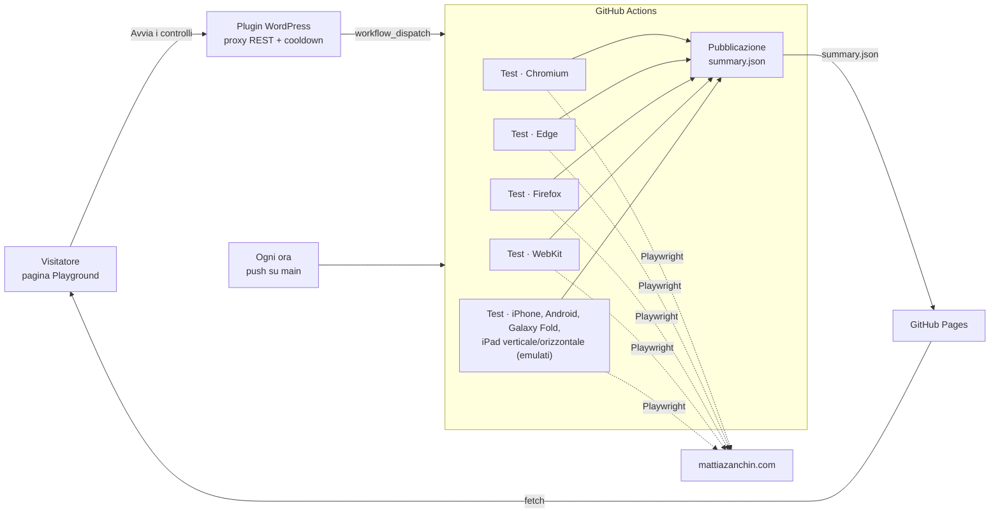

# Website Quality Lab

[](https://github.com/Zancus/website-quality-lab/actions/workflows/e2e-tests.yml)
[](https://mattiazanchin.com/playground/)

🇬🇧 [Read in English](README.md)

Suite di test end-to-end che controlla di continuo il mio sito, [mattiazanchin.com](https://mattiazanchin.com), su quattro browser desktop e cinque dispositivi mobili emulati, e ne pubblica i risultati sul sito stesso.

Nella pagina **[Playground](https://mattiazanchin.com/playground/)** chiunque può vedere gli ultimi risultati, scritti in linguaggio semplice, per tutti i browser o uno alla volta, e **avviare una nuova verifica** su tutti i browser o su uno solo. La pagina è disponibile in italiano e in inglese.

---

## Come funziona



1. I test **Playwright + NUnit** (C#) aprono il sito reale e si comportano come un utente: aprono pagine, cliccano le voci del menu, leggono gli articoli.
2. **GitHub Actions** li esegue ogni ora, a ogni push e su richiesta, su **Chromium, Microsoft Edge, Firefox e WebKit**, più **iPhone, Android, un Galaxy Z Fold chiuso e iPad in verticale e in orizzontale**, emulati con i profili dei dispositivi di Playwright (dimensioni dello schermo, touch, user agent), tutti in parallelo. Le esecuzioni su richiesta possono riguardare un solo browser o dispositivo.
3. Un job di pubblicazione unisce i risultati dei browser e pubblica un `summary.json` compatto su **GitHub Pages**.
4. Un piccolo **plugin WordPress** mostra quel riepilogo nella pagina Playground e permette ai visitatori di avviare i test, passando da un proxy lato server che tiene privato il token GitHub e consente al massimo un'esecuzione ogni 10 minuti.

## Esecuzione in parallelo

Il parallelismo lavora su due livelli; questo progetto per ora usa il primo.

| Livello | Dove | Stato |
|---|---|---|
| **1. Tra macchine** | GitHub Actions avvia un job per browser (`strategy.matrix`): quattro macchine isolate che lavorano contemporaneamente | ✅ in uso |
| **2. Dentro un'esecuzione** | NUnit esegue più test insieme sulla stessa macchina (`[Parallelizable]`, `[LevelOfParallelism]`) | prossimo passo |

Su ogni macchina i test sono **sequenziali**: un'esecuzione dura quanto il **browser più lento**, non la somma dei quattro. La pagina Playground lo mostra con un grafico della durata per browser.

Il livello 2 richiede test che non condividano stato e non dipendano dall'ordine di esecuzione. Questi test lo soddisfano già (leggono soltanto il sito), ma eseguirne molti insieme contro il sito reale deve tenere conto anche della protezione anti-bot dell'hosting.

## Cosa viene verificato

Ogni controllo gira su ogni browser e dispositivo (13 controlli × 9 = 117 esecuzioni). Su smartphone e tablet i test di navigazione aprono prima il menu mobile del sito, come farebbe una persona, quando il sito lo mostra (un iPad in orizzontale riceve il menu desktop).

| Tipo | Area | Controllo | Priorità |
|---|---|---|---|
| Smoke | Disponibilità | Il sito è raggiungibile e si carica correttamente | Blocker |
| Smoke | Navigazione | Ogni voce del menu principale porta alla pagina giusta (6 voci, nell'ordine del menu) | Blocker |
| Regression | Playground | I visitatori possono avviare i controlli (il pulsante è disponibile) | Blocker |
| Regression | Playground | La pagina Playground mostra i risultati aggiornati | Blocker |
| Regression | Articoli tecnici | L'ultimo articolo pubblicato si apre con titolo e contenuto | Major |
| Regression | Playground | La pagina Playground è disponibile anche in inglese | Major |
| Regression | Playground | Si possono vedere i risultati di un singolo browser | Major |
| Regression | Playground | Si possono filtrare i controlli per priorità | Major |

I controlli **smoke** coprono l'essenziale e sono i primi a segnalare un problema; quelli **regression** approfondiscono le singole funzionalità. Sono categorie NUnit, quindi si possono eseguire separatamente.

**Blocker** significa che, se il controllo fallisce, il sito o una sua funzione principale non è utilizzabile; **Major** significa importante, ma un errore non blocca l'uso del sito. Allure non ha un livello "major": Major corrisponde alla severità `normal` di Allure, mostrata come Major nella pagina Playground.

## Stack tecnologico

| | |
|---|---|
| Linguaggio | C# · .NET 10 |
| Automazione del browser | Playwright per .NET |
| Test framework | NUnit 4 |
| Reportistica | Job summary di GitHub Actions |
| CI/CD | GitHub Actions (matrice di browser, esecuzioni programmate e su richiesta) |
| Pubblicazione dei risultati | GitHub Pages |
| Integrazione con il sito | Plugin WordPress (PHP, REST API, JavaScript) |

## Struttura del progetto

```
.
├── .github/workflows/e2e-tests.yml   # CI: matrice di browser + job di pubblicazione
├── Tests/
│   ├── QualityLabTest.cs             # classe base: setup comune, browser nel report
│   ├── WebsiteAvailabilityTests.cs   # smoke
│   ├── NavigationTests.cs            # smoke, generati dalla definizione del menu
│   ├── ArticleTests.cs               # regression
│   └── PlaygroundTests.cs            # regression: la pagina che mostra questi risultati
├── scripts/summary.mjs               # risultati dei test → summary.json per il sito
├── wordpress/quality-lab-playground/ # plugin WordPress (shortcode + proxy REST)
└── QualityLab.csproj
```

## Esecuzione in locale

Requisiti: [.NET 10 SDK](https://dotnet.microsoft.com/download).

```bash
# Build e installazione dei browser (solo la prima volta)
dotnet build
pwsh bin/Debug/net10.0/playwright.ps1 install chromium firefox webkit

# Tutti i test (Chromium di default)
dotnet test

# Scelta del browser
BROWSER=webkit dotnet test

# Dispositivi emulati: iphone, android, fold, ipad, ipadland (WebKit per iPhone/iPad, Chromium per Android/Fold)
QLP_DEVICE=iphone BROWSER=webkit dotnet test

# Microsoft Edge (Chromium con il channel msedge; Edge deve essere installato)
dotnet test -- Playwright.LaunchOptions.Channel=msedge

# Solo i controlli smoke
dotnet test --filter TestCategory=Smoke
```

## Scelte di progettazione

- **Risultati in linguaggio semplice.** I nomi dei test sono scritti per chi non è tecnico: sul sito compaiono frasi come “Il sito è raggiungibile e si carica correttamente” invece dei nomi dei metodi.
- **Dispositivi mostrati dentro il loro browser.** Smartphone e tablet emulati usano lo stesso motore di un browser desktop, quindi la Playground li raggruppa: Safari comprende iPhone e iPad, Chrome comprende Android e Galaxy Fold. Ogni browser mostra gli stessi 13 controlli; un controllo è superato su Safari solo se passa su computer, iPhone e iPad, e il tooltip indica la variante che non è passata. I dati in `summary.json` restano separati per dispositivo.
- **Avanzamento in diretta.** Durante un'esecuzione ogni test comunica *iniziato / superato / fallito* al plugin WordPress (`Tests/LiveProgress.cs`, autenticato con una chiave segreta condivisa). La Playground mostra quale controllo è in corso su quale browser e una barra che avanza in modo continuo, ma non supera mai l'avanzamento reale né torna indietro. L'invio è "spara e dimentica": se non riesce, i test non ne risentono.
- **L'ordine nasce dai dati, non dall'HTML.** La pagina Playground elenca i controlli per priorità (prima gli smoke, poi la severità, poi la posizione nel menu), calcolata dai metadati dei test in `summary.json`.
- **Il menu è definito una volta sola.** I test di navigazione sono generati con `[TestCaseSource]` da un unico array ordinato: per aggiornare il menu basta modificare una riga.
- **Sicurezza del pulsante.** Il token GitHub sta solo in `wp-config.php`; il browser parla con WordPress, mai con GitHub. Un cooldown globale e il controllo delle esecuzioni già in corso evitano abusi.
- **La protezione anti-bot non è un errore del sito.** Se la protezione anti-bot dell'hosting mostra un CAPTCHA al browser di test, il controllo viene segnato come *non verificabile* (`Assert.Ignore`, con il motivo) invece che fallito. I test non provano mai a superare un CAPTCHA.
- **I test non si avviano da soli.** Il test della Playground verifica che il pulsante esista ma non lo clicca, altrimenti ogni esecuzione oraria ne avvierebbe un'altra.

## Autore

**Mattia Zanchin** · Software Tester · [mattiazanchin.com](https://mattiazanchin.com)
