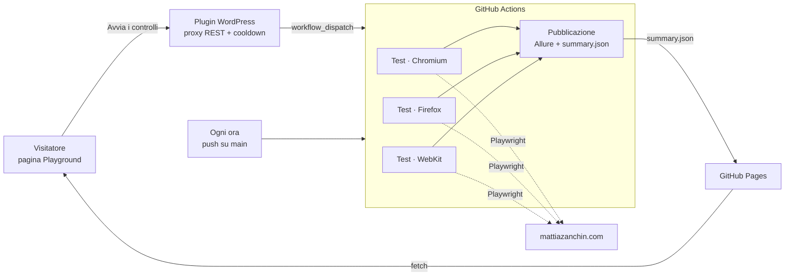

# Website Quality Lab

[](https://github.com/Zancus/website-quality-lab/actions/workflows/e2e-tests.yml)
[](https://mattiazanchin.com/playground/)

🇬🇧 [Read in English](README.md)

Suite di test end-to-end che controlla di continuo il mio sito, [mattiazanchin.com](https://mattiazanchin.com), su tre browser, e ne pubblica i risultati sul sito stesso.

Nella pagina **[Playground](https://mattiazanchin.com/playground/)** chiunque può vedere gli ultimi risultati, scritti in linguaggio semplice, e **avviare una nuova verifica** con un clic.

---

## Come funziona



1. I test **Playwright + NUnit** (C#) aprono il sito reale e si comportano come un utente: aprono pagine, cliccano le voci del menu, leggono gli articoli.
2. **GitHub Actions** li esegue ogni ora, a ogni push e su richiesta, su **Chromium, Firefox e WebKit** in parallelo.
3. Un job di pubblicazione unisce i risultati, genera il report **Allure 3** e pubblica un `summary.json` compatto su **GitHub Pages**.
4. Un piccolo **plugin WordPress** mostra quel riepilogo nella pagina Playground e permette ai visitatori di avviare i test, passando da un proxy lato server che tiene privato il token GitHub e consente al massimo un'esecuzione ogni 10 minuti.

## Cosa viene verificato

Ogni controllo gira su tutti e tre i browser (10 controlli × 3 browser = 30 esecuzioni).

| Tipo | Area | Controllo | Severità |
|---|---|---|---|
| Smoke | Disponibilità | Il sito è raggiungibile e si carica correttamente | blocker |
| Smoke | Navigazione | Ogni voce del menu principale porta alla pagina giusta (6 voci, nell'ordine del menu) | critical |
| Regression | Articoli tecnici | L'ultimo articolo pubblicato si apre con titolo e contenuto | normal |
| Regression | Playground | La pagina Playground mostra i risultati aggiornati | normal |
| Regression | Playground | I visitatori possono avviare i controlli (il pulsante è disponibile) | normal |

I controlli **smoke** coprono l'essenziale e sono i primi a segnalare un problema; quelli **regression** approfondiscono le singole funzionalità. Sono categorie NUnit, quindi si possono eseguire separatamente.

## Stack tecnologico

| | |
|---|---|
| Linguaggio | C# · .NET 10 |
| Automazione del browser | Playwright per .NET |
| Test framework | NUnit 4 |
| Reportistica | Allure 3 · Job summary di GitHub Actions |
| CI/CD | GitHub Actions (matrice di browser, esecuzioni programmate e su richiesta) |
| Pubblicazione dei risultati | GitHub Pages |
| Integrazione con il sito | Plugin WordPress (PHP, REST API, JavaScript) |

## Struttura del progetto

```
.
├── .github/workflows/e2e-tests.yml   # CI: matrice di browser + job di pubblicazione
├── Tests/
│   ├── QualityLabTest.cs             # classe base: setup comune, browser nel report
│   ├── WebsiteAvailabilityTests.cs   # smoke
│   ├── NavigationTests.cs            # smoke, generati dalla definizione del menu
│   ├── ArticleTests.cs               # regression
│   └── PlaygroundTests.cs            # regression: la pagina che mostra questi risultati
├── scripts/summary.mjs               # risultati Allure → summary.json per il sito
├── wordpress/quality-lab-playground/ # plugin WordPress (shortcode + proxy REST)
├── allureConfig.json                 # impostazioni dell'adapter Allure per .NET
├── allurerc.mjs                      # impostazioni del report Allure 3
└── QualityLab.csproj
```

## Esecuzione in locale

Requisiti: [.NET 10 SDK](https://dotnet.microsoft.com/download) e, per il report HTML, [Node.js](https://nodejs.org) LTS.

```bash
# Build e installazione dei browser (solo la prima volta)
dotnet build
pwsh bin/Debug/net10.0/playwright.ps1 install chromium firefox webkit

# Tutti i test (Chromium di default)
dotnet test

# Scelta del browser
BROWSER=webkit dotnet test

# Solo i controlli smoke
dotnet test --filter TestCategory=Smoke

# Generazione e apertura del report Allure
npm ci
npm run report -- --clean && npx allure open
```

## Scelte di progettazione

- **Risultati in linguaggio semplice.** I nomi dei test sono scritti per chi non è tecnico, con `[AllureName]` e `AllureApi.SetTestName`: gli stessi nomi compaiono in Allure e sul sito.
- **L'ordine nasce dai dati, non dall'HTML.** La pagina Playground elenca i controlli per priorità (prima gli smoke, poi la severità, poi la posizione nel menu), calcolata dai metadati dei test in `summary.json`.
- **Il menu è definito una volta sola.** I test di navigazione sono generati con `[TestCaseSource]` da un unico array ordinato: per aggiornare il menu basta modificare una riga.
- **Sicurezza del pulsante.** Il token GitHub sta solo in `wp-config.php`; il browser parla con WordPress, mai con GitHub. Un cooldown globale e il controllo delle esecuzioni già in corso evitano abusi.
- **I test non si avviano da soli.** Il test della Playground verifica che il pulsante esista ma non lo clicca, altrimenti ogni esecuzione oraria ne avvierebbe un'altra.
- **Privacy del report.** Il report Allure completo resta un artifact del workflow; è pubblico solo il riepilogo che serve al sito.

## Autore

**Mattia Zanchin** · Software Tester · [mattiazanchin.com](https://mattiazanchin.com)
