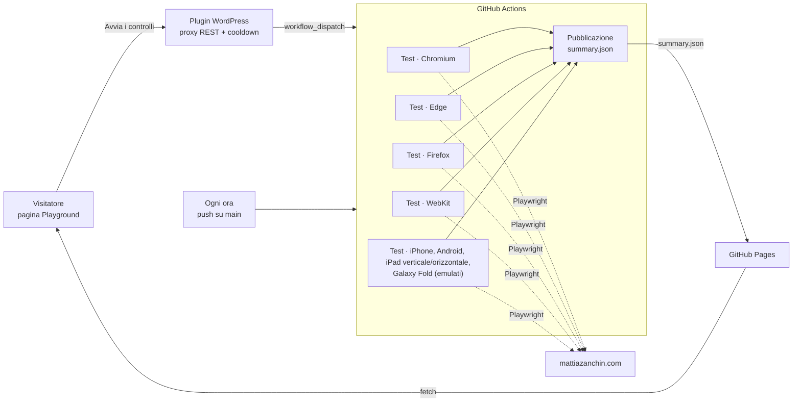

# Website Quality Lab

[](https://github.com/MattiaZanchin94/website-quality-lab/actions/workflows/e2e-tests.yml)
[](https://github.com/MattiaZanchin94/website-quality-lab/releases/latest)
[](https://mattiazanchin.com/playground/)

🇬🇧 [Read in English](README.md)

Suite di test end-to-end che controlla di continuo il mio sito, [mattiazanchin.com](https://mattiazanchin.com), su quattro browser per computer e cinque smartphone e tablet emulati, ne verifica la sicurezza con controlli passivi e pubblica i risultati sul sito stesso.

Nella pagina **[Playground](https://mattiazanchin.com/playground/)** chiunque può vedere gli ultimi risultati, scritti in linguaggio semplice, e **avviare una nuova verifica**. La pagina riconosce il dispositivo di chi la visita: da computer apre i browser per computer, da iPhone, Android o iPad apre ed esegue l'emulazione di quel dispositivo. La pagina ha due schede, **Funzionalità** (computer, smartphone e tablet) e **Sicurezza** (connessione cifrata, certificato e protezioni del sito), ognuna con il suo pulsante: si possono avviare le due verifiche anche nello stesso momento. La scheda Sicurezza ha un indirizzo proprio, [/playground/#sicurezza](https://mattiazanchin.com/playground/#sicurezza). La pagina è disponibile in italiano e in inglese.

---

## Come funziona



1. I test **Playwright + NUnit** (C#) aprono il sito reale e si comportano come un utente: aprono pagine, cliccano le voci del menu, leggono gli articoli.
2. **GitHub Actions** li esegue ogni ora, a ogni push e su richiesta, su **Chromium (Chrome), Microsoft Edge, Firefox e WebKit (Safari)**, più **iPhone, Android, iPad in verticale e in orizzontale e un Galaxy Z Fold chiuso**, emulati con i profili dei dispositivi di Playwright (dimensioni dello schermo, touch, user agent), tutti in parallelo. Le esecuzioni su richiesta possono riguardare i browser per computer, i dispositivi, oppure uno solo di loro.
3. Un job di pubblicazione unisce i risultati dei browser e pubblica un `summary.json` compatto su **GitHub Pages**.
4. Un piccolo **plugin WordPress** mostra quel riepilogo nella pagina Playground e permette ai visitatori di avviare i test, passando da un proxy lato server che tiene privato il token GitHub e consente al massimo un'esecuzione ogni 10 minuti per le funzionalità e ogni 5 per la sicurezza.

## Esecuzione in parallelo

Il parallelismo lavora su due livelli; questo progetto per ora usa il primo.

| Livello | Dove | Stato |
|---|---|---|
| **1. Tra macchine** | GitHub Actions avvia un job per browser o dispositivo (`strategy.matrix`): nove macchine isolate che lavorano contemporaneamente | ✅ in uso |
| **2. Dentro un'esecuzione** | NUnit esegue più test insieme sulla stessa macchina (`[Parallelizable]`, `[LevelOfParallelism]`) | prossimo passo |

Su ogni macchina i test sono **sequenziali**: un'esecuzione dura quanto la **macchina più lenta**, non la somma di tutte. La pagina Playground lo mostra con un grafico della durata per browser (sezione Computer) o per dispositivo (sezione Smartphone e tablet), accanto alla **durata totale su GitHub**, che comprende anche la preparazione delle macchine e la pubblicazione dei risultati.

Il livello 2 richiede test che non condividano stato e non dipendano dall'ordine di esecuzione. Questi test lo soddisfano già (leggono soltanto il sito), ma eseguirne molti insieme contro il sito reale deve tenere conto anche della protezione anti-bot dell'hosting.

## Cosa viene verificato

I 14 controlli funzionali girano su ogni browser e dispositivo (14 × 9 = 126 esecuzioni); i 10 controlli di sicurezza danno lo stesso risultato con qualsiasi browser e girano una volta sola, su Chromium (136 esecuzioni in tutto). Su smartphone e tablet i test di navigazione aprono prima il menu mobile del sito, come farebbe una persona, quando il sito lo mostra (un iPad in orizzontale riceve il menu desktop).

| Tipo | Area | Controllo | Priorità |
|---|---|---|---|
| Smoke | Disponibilità | Il sito è raggiungibile e si carica correttamente | Blocker |
| Smoke | Navigazione | Ogni voce del menu principale porta alla pagina giusta (6 voci, nell'ordine del menu) | Blocker |
| Regression | Playground | I visitatori possono avviare i controlli (il pulsante è disponibile) | Blocker |
| Regression | Playground | La pagina Playground mostra i risultati aggiornati | Blocker |
| Regression | Articoli tecnici | L'ultimo articolo pubblicato si apre con titolo e contenuto | Major |
| Regression | Playground | La pagina Playground è disponibile anche in inglese | Major |
| Regression | Playground | Si possono vedere i risultati di un singolo browser | Major |
| Regression | Playground | Si possono filtrare i controlli per priorità | Major |
| Regression | Privacy | Il sito rispetta il consenso ai cookie (GDPR): niente Google Analytics né servizi esterni prima della scelta e dopo il rifiuto | Major |
| Smoke | Sicurezza | Il sito usa sempre una connessione sicura: http e www portano a https con redirect permanenti | Blocker |
| Smoke | Sicurezza | Il certificato di sicurezza è valido e non scade nei prossimi 14 giorni | Blocker |
| Regression | Sicurezza | L'elenco degli utenti non è pubblico (API utenti, pagine autore, anteprima dei link) | Blocker |
| Regression | Sicurezza | Il browser è obbligato a usare HTTPS (HSTS di almeno 6 mesi) | Major |
| Regression | Sicurezza | Il sito non può essere inserito in altri siti (X-Frame-Options, contro il clickjacking) | Major |
| Regression | Sicurezza | Il browser riceve le protezioni di base (nosniff, Referrer-Policy) | Major |
| Regression | Sicurezza | I file di sistema non sono accessibili (readme, log, configurazione, elenco dei file, XML-RPC) | Major |
| Regression | Sicurezza | Le pagine non caricano contenuti non protetti (niente http:// in pagine https) | Major |
| Regression | Sicurezza | I cookie del sito sono protetti (Secure e SameSite) | Major |
| Regression | Sicurezza | L'API del Playground accetta solo richieste autorizzate (avanzamento solo con la chiave, nessun segreto nelle risposte) | Major |

I controlli **smoke** coprono l'essenziale e sono i primi a segnalare un problema; quelli **regression** approfondiscono le singole funzionalità. Sono categorie NUnit, quindi si possono eseguire separatamente.

**Blocker** significa che, se il controllo fallisce, il sito o una sua funzione principale non è utilizzabile; **Major** significa importante, ma un errore non blocca l'uso del sito. Allure non ha un livello "major": Major corrisponde alla severità `normal` di Allure, mostrata come Major nella pagina Playground.

## Stack tecnologico

| | |
|---|---|
| Linguaggio | C# · .NET 10 |
| Automazione del browser | Playwright per .NET |
| Test framework | NUnit 4 |
| Reportistica | Job summary di GitHub Actions |
| CI/CD | GitHub Actions (matrice di browser e dispositivi nel contenitore ufficiale di Playwright, esecuzioni programmate e su richiesta) |
| Pubblicazione dei risultati | GitHub Pages |
| Integrazione con il sito | Plugin WordPress (PHP, REST API, JavaScript) |
| Avvisi | Telegram, per ricevere un messaggio quando qualcosa non va nel sito e quando torna a funzionare |

## Struttura del progetto

```
.
├── .github/workflows/e2e-tests.yml   # CI: matrice di browser + job di pubblicazione
├── Tests/
│   ├── QualityLabTest.cs             # classe base: setup comune, browser nel report
│   ├── WebsiteAvailabilityTests.cs   # smoke
│   ├── NavigationTests.cs            # smoke, generati dalla definizione del menu
│   ├── ArticleTests.cs               # regression
│   ├── PlaygroundTests.cs            # regression: la pagina che mostra questi risultati
│   ├── PrivacyTests.cs               # regression: consenso ai cookie (GDPR)
│   └── SecurityTests.cs              # regression: sicurezza, controlli passivi (solo Chromium in CI)
├── scripts/summary.mjs               # risultati dei test → summary.json per il sito
├── scripts/notify.mjs                # avviso su Telegram quando il sito ha un problema e quando torna a posto
├── wordpress/quality-lab-playground/ # plugin WordPress (shortcode + proxy REST)
└── QualityLab.csproj
```

## Esecuzione in locale

Requisiti: [.NET 10 SDK](https://dotnet.microsoft.com/download).

```bash
# Build e installazione dei browser (solo la prima volta)
dotnet build
pwsh bin/Debug/net10.0/playwright.ps1 install chromium firefox webkit

# Tutti i test (Chromium di default)
dotnet test

# Scelta del browser
BROWSER=webkit dotnet test

# Dispositivi emulati: iphone, android, fold, ipad, ipadland (WebKit per iPhone/iPad, Chromium per Android/Fold)
QLP_DEVICE=iphone BROWSER=webkit dotnet test

# Microsoft Edge (Chromium con il channel msedge; Edge deve essere installato)
dotnet test -- Playwright.LaunchOptions.Channel=msedge

# Solo i controlli smoke
dotnet test --filter TestCategory=Smoke

# Solo i controlli di sicurezza
dotnet test --filter TestCategory=Security
```

## Scelte di progettazione

- **Risultati in linguaggio semplice.** I nomi dei test sono scritti per chi non è tecnico: sul sito compaiono frasi come “Il sito è raggiungibile e si carica correttamente” invece dei nomi dei metodi.
- **La Playground segue il dispositivo di chi la visita.** Due sezioni, *Computer* e *Smartphone e tablet*, ognuna con i suoi risultati, il suo grafico delle durate e il suo pulsante, così il "più lento" si riferisce sempre alle macchine di quella sezione. La pagina apre la sezione e la scheda del dispositivo di chi visita (iPhone, Android, iPad, anche quando iPadOS si presenta come un Mac) e il pulsante verifica solo quel dispositivo; le schede permettono di guardare anche gli altri. Il Galaxy Fold chiuso gira solo nelle esecuzioni automatiche.
- **CI affidabile.** I test girano nel contenitore ufficiale di Playwright, che contiene già i browser e le loro dipendenze di sistema: durante l'esecuzione si installa solo Microsoft Edge, con limiti di tempo e tentativi ripetuti.
- **Avanzamento in diretta.** Durante un'esecuzione ogni test comunica *iniziato / superato / fallito* al plugin WordPress (`Tests/LiveProgress.cs`, autenticato con una chiave segreta condivisa). La Playground mostra quale controllo è in corso su quale browser e una barra che avanza in modo continuo, ma non supera mai l'avanzamento reale né torna indietro. L'invio è "spara e dimentica": se non riesce, i test non ne risentono.
- **L'ordine nasce dai dati, non dall'HTML.** La pagina Playground elenca i controlli per priorità (prima gli smoke, poi la severità, poi la posizione nel menu), calcolata dai metadati dei test in `summary.json`.
- **Il menu è definito una volta sola.** I test di navigazione sono generati con `[TestCaseSource]` da un unico array ordinato: per aggiornare il menu basta modificare una riga.
- **Sicurezza del pulsante.** Il token GitHub sta solo in `wp-config.php`; il browser parla con WordPress, mai con GitHub. Un cooldown globale e il controllo delle esecuzioni già in corso evitano abusi.
- **La protezione anti-bot non è un errore del sito.** Se la protezione anti-bot dell'hosting mostra un CAPTCHA al browser di test, il controllo viene segnato come *non verificabile* (`Assert.Ignore`, con il motivo) invece che fallito. I test non provano mai a superare un CAPTCHA.
- **Un avviso quando qualcosa non va.** Se i controlli essenziali (smoke: sito raggiungibile, menu, HTTPS e certificato) segnalano un problema sul sito, ricevo un messaggio su Telegram; un secondo messaggio arriva quando il problema è risolto.
- **I test rispettano il banner dei cookie.** Il sito chiede il consenso ai cookie: i test si comportano come un visitatore attento alla privacy e, quando il banner compare, lo rifiutano. Gli invii di dati a Google Analytics vengono comunque bloccati, così le esecuzioni automatiche non finiscono nelle statistiche delle visite.
- **La privacy si verifica, non si dà per scontata.** Il controllo sul consenso ai cookie osserva cosa succede davvero nel browser: prima della scelta e dopo il rifiuto non devono esserci cookie di Google Analytics né servizi esterni, e Google deve ricevere solo segnali con consenso negato. Girando da server negli Stati Uniti, ha scoperto che fuori dall'Europa le statistiche partivano prima del consenso: ora il sito chiede il consenso a tutti, ovunque si trovino.
- **Sicurezza verificata senza attaccare.** I controlli di sicurezza sono passivi: leggono redirect, header, certificato e file pubblici come farebbe un browser, senza scansioni aggressive (su un hosting condiviso equivarrebbero a un attacco). Il primo controllo, che segue ogni redirect un passaggio alla volta, ha scoperto che solo la home passava a HTTPS: le altre pagine si aprivano anche in chiaro. Ora il server forza HTTPS ovunque.
- **Due campetti indipendenti.** Funzionalità e Sicurezza hanno ciascuna la sua coda su GitHub Actions (`concurrency` per campetto), la sua pausa tra un avvio e l'altro e la sua barra di avanzamento: una verifica di sicurezza (circa un minuto) può girare mentre ne è in corso una sui browser. Le pubblicazioni dei risultati invece restano in fila, e `summary.mjs` aggiorna solo i controlli rieseguiti: una partita su un solo campetto o un solo dispositivo non cancella gli altri risultati.
- **Ogni controllo è un tiro a canestro.** Durante una partita in diretta, sotto la barra di avanzamento c'è un piccolo campo, che compare appena si preme il pulsante, con un giocatore che palleggia mentre le macchine si preparano. Quando un controllo finisce salta e tira: se il controllo passa la palla entra pulita e lui esulta, se non passa la palla prende il ferro ed esce e lui si mette le mani sulla testa, con il punteggio *Canestri / Ferri* della partita. Tiri e punteggio riguardano solo quello che si sta guardando: la sezione aperta (Computer o Smartphone e tablet) e, se scelta, la scheda di un solo browser. Con le animazioni ridotte nelle preferenze del sistema resta solo il testo.
- **Ogni controllo di sicurezza si spiega da solo.** Accanto al nome c'è un'icona ⓘ che apre una finestra con *cosa verifica* e *perché è importante*, in parole semplici. I testi stanno nei test C# (label Allure `explain_*`), quindi spiegazione e controllo restano sempre allineati.
- **Il codice mio si verifica come il resto.** L'API del plugin Playground ha i suoi test "negativi": senza la chiave segreta, o con una chiave sbagliata, non si può scrivere l'avanzamento in diretta, e le risposte pubbliche non contengono token. Il test non avvia mai una verifica vera.
- **Statistiche senza dati personali.** La Playground invia a Google Analytics tre eventi: `playground_tab` (quale scheda viene aperta), `playground_run` (quale verifica viene avviata) e `playground_explain` (quale spiegazione viene letta). Passano dallo stesso Google Analytics del sito, quindi rispettano la scelta fatta nel banner dei cookie.
- **Prima si corregge, poi si pubblica.** I punti deboli trovati (nome utente ricavabile dall'API, header mancanti, pagine in http) sono stati corretti prima di mostrare i controlli nella Playground: una pagina pubblica non deve diventare la mappa delle debolezze del sito.
- **Un intoppo di rete non è un sito giù.** Se la connessione cade mentre una pagina si apre, il test riprova fino a due volte; un sito davvero irraggiungibile fa comunque fallire il controllo.
- **I test non si avviano da soli.** Il test della Playground verifica che il pulsante esista ma non lo clicca, altrimenti ogni esecuzione oraria ne avvierebbe un'altra.

## Autore

**Mattia Zanchin** · Software Tester · [mattiazanchin.com](https://mattiazanchin.com)
