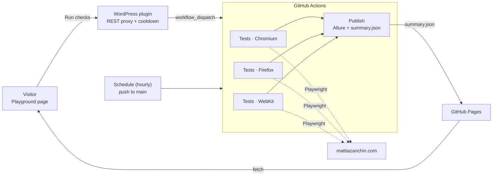

# Website Quality Lab

[](https://github.com/Zancus/website-quality-lab/actions/workflows/e2e-tests.yml)
[](https://mattiazanchin.com/playground/)

🇮🇹 [Leggi in italiano](README.it.md)

End-to-end test suite that continuously checks my website, [mattiazanchin.com](https://mattiazanchin.com), on three browsers, and publishes the results on the site itself.

On the **[Playground](https://mattiazanchin.com/playground/)** page anyone can see the latest results in plain language and **start a new test run** with one click.

---

## How it works



1. **Playwright + NUnit** tests (C#) open the real site and act like a user: open pages, click menu items, read articles.
2. **GitHub Actions** runs them every hour, on every push, and on demand, on **Chromium, Firefox and WebKit** in parallel.
3. A publish job merges the results, generates the **Allure 3** report, and deploys a compact `summary.json` to **GitHub Pages**.
4. A small **WordPress plugin** shows that summary on the Playground page and lets visitors start a run, through a server-side proxy that keeps the GitHub token private and allows at most one run every 10 minutes.

## What is tested

Each check runs on all three browsers (10 checks × 3 browsers = 30 runs).

| Type | Area | Check | Severity |
|---|---|---|---|
| Smoke | Availability | The site is reachable and loads correctly | blocker |
| Smoke | Navigation | Each main menu item opens the right page (6 items, in menu order) | critical |
| Regression | Technical articles | The latest article opens with matching title and content | normal |
| Regression | Playground | The Playground page shows up-to-date results | normal |
| Regression | Playground | Visitors can start a run (the button is available) | normal |

**Smoke** checks cover the essentials and are the first to flag a problem; **regression** checks go deeper into single features. Both are NUnit categories, so they can be run separately.

## Tech stack

| | |
|---|---|
| Language | C# · .NET 10 |
| Browser automation | Playwright for .NET |
| Test framework | NUnit 4 |
| Reporting | Allure 3 · GitHub Actions job summary |
| CI/CD | GitHub Actions (browser matrix, scheduled and on-demand runs) |
| Hosting of results | GitHub Pages |
| Website integration | WordPress plugin (PHP, REST API, vanilla JS) |

## Project structure

```
.
├── .github/workflows/e2e-tests.yml   # CI: browser matrix + publish job
├── Tests/
│   ├── QualityLabTest.cs             # base class: shared setup, browser tagging
│   ├── WebsiteAvailabilityTests.cs   # smoke
│   ├── NavigationTests.cs            # smoke, data-driven from the menu definition
│   ├── ArticleTests.cs               # regression
│   └── PlaygroundTests.cs            # regression: the page that shows these results
├── scripts/summary.mjs               # Allure results → summary.json for the website
├── wordpress/quality-lab-playground/ # WordPress plugin (shortcode + REST proxy)
├── allureConfig.json                 # Allure .NET adapter settings
├── allurerc.mjs                      # Allure 3 report settings
└── QualityLab.csproj
```

## Run locally

Requirements: [.NET 10 SDK](https://dotnet.microsoft.com/download) and, for the HTML report, [Node.js](https://nodejs.org) LTS.

```bash
# Build and install the browsers (first time only)
dotnet build
pwsh bin/Debug/net10.0/playwright.ps1 install chromium firefox webkit

# Run all tests (Chromium by default)
dotnet test

# Choose the browser
BROWSER=webkit dotnet test

# Run only the smoke checks
dotnet test --filter TestCategory=Smoke

# Generate and open the Allure report
npm ci
npm run report -- --clean && npx allure open
```

## Design notes

- **Plain-language results.** Test names are written for non-technical readers with `[AllureName]` and `AllureApi.SetTestName`, so the same names appear in Allure and on the website.
- **Order from data, not markup.** The Playground page lists checks by priority (smoke first, then severity, then menu position), computed from test metadata in `summary.json`.
- **One source of truth for the menu.** Navigation tests are generated with `[TestCaseSource]` from a single ordered array: updating the menu means editing one line.
- **Security of the run button.** The GitHub token lives only in `wp-config.php`; the browser talks to WordPress, never to GitHub. A global cooldown and a check for runs already in progress prevent abuse.
- **The checks never trigger themselves.** The Playground test verifies that the run button exists but never clicks it, otherwise every hourly run would start another one.
- **Report privacy.** The full Allure report is kept as a workflow artifact; only the summary needed by the website is public.

## Author

**Mattia Zanchin** · Software Tester · [mattiazanchin.com](https://mattiazanchin.com)
