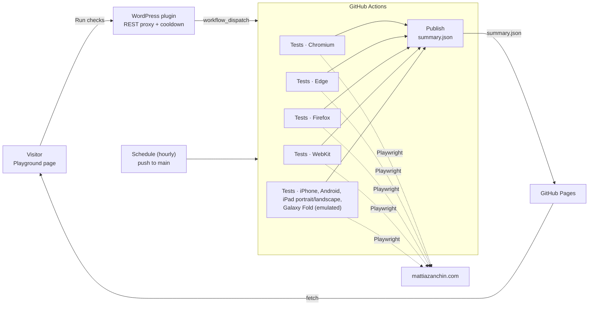

# Website Quality Lab

[](https://github.com/MattiaZanchin94/website-quality-lab/actions/workflows/e2e-tests.yml)
[](https://github.com/MattiaZanchin94/website-quality-lab/releases/latest)
[](https://mattiazanchin.com/playground/)

🇮🇹 [Leggi in italiano](README.it.md)

End-to-end test suite that continuously checks my website, [mattiazanchin.com](https://mattiazanchin.com), on four desktop browsers and five emulated phones and tablets, checks its security with passive checks and publishes the results on the site itself.

On the **[Playground](https://mattiazanchin.com/playground/)** page anyone can see the latest results in plain language and **start a new test run**. The page recognises the visitor's device: from a computer it opens the desktop browsers, from an iPhone, an Android phone or an iPad it opens and runs that emulated device. The page has two tabs, **Functionality** (desktop, phones and tablets) and **Security** (encrypted connection, certificate and site protections), each with its own run button: the two checks can even run at the same time. The Security tab has its own address, [/playground/#security](https://mattiazanchin.com/en/playground/#security). The page is available in Italian and English.

---

## How it works



1. **Playwright + NUnit** tests (C#) open the real site and act like a user: open pages, click menu items, read articles.
2. **GitHub Actions** runs them every hour, on every push, and on demand, on **Chromium (Chrome), Microsoft Edge, Firefox and WebKit (Safari)**, plus **iPhone, Android, iPad in portrait and landscape and a folded Galaxy Z Fold**, emulated with Playwright device profiles (screen size, touch, user agent), all in parallel. On demand runs can target the desktop browsers, the devices, or a single one of them.
3. A publish job merges the results of the browsers and deploys a compact `summary.json` to **GitHub Pages**.
4. A small **WordPress plugin** shows that summary on the Playground page and lets visitors start a run, through a server-side proxy that keeps the GitHub token private and allows at most one run every 10 minutes for functionality and every 5 for security.

## Parallel execution

Parallelism works on two levels; this project currently uses the first one.

| Level | Where | Status |
|---|---|---|
| **1. Across machines** | GitHub Actions starts one job per browser or device (`strategy.matrix`): nine isolated machines that run at the same time | ✅ in use |
| **2. Within a run** | NUnit runs several tests at the same time on one machine (`[Parallelizable]`, `[LevelOfParallelism]`) | next step |

On each machine the tests run **sequentially**, so a run lasts as long as the **slowest machine**, not the sum of all of them. The Playground page shows this as a duration chart per browser (Desktop section) or per device (Phones and tablets section), next to the **total time on GitHub**, which also includes preparing the machines and publishing the results.

Level 2 needs tests that share no state and don't depend on each other's order. These tests already qualify (they only read the site), but running many of them at once against the live site also has to account for the hosting provider's anti-bot protection.

## What is tested

The 14 functional checks run on every browser and device (14 × 9 = 126 runs); the 10 security checks give the same result with any browser and run once, on Chromium (136 runs in total). On phones and tablets the navigation tests open the site's mobile menu first, like a person would, when the site shows it (an iPad in landscape gets the desktop menu).

| Type | Area | Check | Priority |
|---|---|---|---|
| Smoke | Availability | The site is reachable and loads correctly | Blocker |
| Smoke | Navigation | Each main menu item opens the right page (6 items, in menu order) | Blocker |
| Regression | Playground | Visitors can start a run (the button is available) | Blocker |
| Regression | Playground | The Playground page shows up-to-date results | Blocker |
| Regression | Technical articles | The latest article opens with matching title and content | Major |
| Regression | Playground | The Playground page is also available in English | Major |
| Regression | Playground | Results can be viewed for a single browser | Major |
| Regression | Playground | Checks can be filtered by priority | Major |
| Regression | Privacy | The site respects cookie consent (GDPR): no Google Analytics or external services before the choice and after rejecting | Major |
| Smoke | Security | The site always uses a secure connection: http and www lead to https with permanent redirects | Blocker |
| Smoke | Security | The security certificate is valid and doesn't expire in the next 14 days | Blocker |
| Regression | Security | The list of users is not public (users API, author pages, link previews) | Blocker |
| Regression | Security | Browsers are required to use HTTPS (HSTS of at least 6 months) | Major |
| Regression | Security | The site cannot be embedded in other sites (X-Frame-Options, against clickjacking) | Major |
| Regression | Security | Browsers receive the basic protections (nosniff, Referrer-Policy) | Major |
| Regression | Security | System files are not accessible (readme, logs, configuration, file listings, XML-RPC) | Major |
| Regression | Security | Pages don't load unprotected content (no http:// in https pages) | Major |
| Regression | Security | The site's cookies are protected (Secure and SameSite) | Major |
| Regression | Security | The Playground API only accepts authorised requests (live progress only with the key, no secrets in responses) | Major |

**Smoke** checks cover the essentials and are the first to flag a problem; **regression** checks go deeper into single features. Both are NUnit categories, so they can be run separately.

**Blocker** means that if the check fails, the site or one of its main functions can't be used; **Major** means important, but a failure doesn't block the site. Allure has no "major" level, so Major is Allure's `normal` severity, displayed as Major on the Playground page.

## Tech stack

| | |
|---|---|
| Language | C# · .NET 10 |
| Browser automation | Playwright for .NET |
| Test framework | NUnit 4 |
| Reporting | GitHub Actions job summary |
| CI/CD | GitHub Actions (browser and device matrix in the official Playwright container, scheduled and on-demand runs) |
| Hosting of results | GitHub Pages |
| Website integration | WordPress plugin (PHP, REST API, vanilla JS) |
| Alerts | Telegram, to get a message when something is wrong with the site and when it works again |

## Project structure

```
.
├── .github/workflows/e2e-tests.yml   # CI: browser matrix + publish job
├── Tests/
│   ├── QualityLabTest.cs             # base class: shared setup, browser tagging
│   ├── WebsiteAvailabilityTests.cs   # smoke
│   ├── NavigationTests.cs            # smoke, data-driven from the menu definition
│   ├── ArticleTests.cs               # regression
│   ├── PlaygroundTests.cs            # regression: the page that shows these results
│   ├── PrivacyTests.cs               # regression: cookie consent (GDPR)
│   └── SecurityTests.cs              # regression: security, passive checks (Chromium only in CI)
├── scripts/summary.mjs               # test results → summary.json for the website
├── scripts/notify.mjs                # Telegram alert when the site has a problem and when it recovers
├── wordpress/quality-lab-playground/ # WordPress plugin (shortcode + REST proxy)
└── QualityLab.csproj
```

## Run locally

Requirements: [.NET 10 SDK](https://dotnet.microsoft.com/download).

```bash
# Build and install the browsers (first time only)
dotnet build
pwsh bin/Debug/net10.0/playwright.ps1 install chromium firefox webkit

# Run all tests (Chromium by default)
dotnet test

# Choose the browser
BROWSER=webkit dotnet test

# Emulated devices: iphone, android, fold, ipad, ipadland (WebKit for iPhone/iPad, Chromium for Android/Fold)
QLP_DEVICE=iphone BROWSER=webkit dotnet test

# Microsoft Edge (Chromium with the msedge channel; Edge must be installed)
dotnet test -- Playwright.LaunchOptions.Channel=msedge

# Run only the smoke checks
dotnet test --filter TestCategory=Smoke

# Run only the security checks
dotnet test --filter TestCategory=Security
```

## Design notes

- **Plain-language results.** Test names are written for non-technical readers, so the website shows sentences like “The site is reachable and loads correctly” instead of method names.
- **The Playground follows the visitor's device.** Two sections, *Desktop* and *Phones and tablets*, each with its own results, duration chart and run button, so the "slowest" always refers to the machines of that section. The page opens the section and tab of the visitor's device (iPhone, Android, iPad, also when iPadOS presents itself as a Mac) and the run button checks only that device; tabs let anyone look at the others. The folded Galaxy Fold runs only in the automatic runs.
- **Reliable CI.** The tests run in the official Playwright container, which already ships the browsers and their system dependencies: only Microsoft Edge is installed during the run, with timeouts and retries.
- **Live progress.** During a run each test reports *started / passed / failed* to the WordPress plugin (`Tests/LiveProgress.cs`, authenticated with a shared secret). The Playground shows which check is running on which browser and a progress bar that moves continuously but never runs ahead of the real progress or goes backwards. Reporting is fire-and-forget: if it fails, the tests are unaffected.
- **Order from data, not markup.** The Playground page lists checks by priority (smoke first, then severity, then menu position), computed from test metadata in `summary.json`.
- **One source of truth for the menu.** Navigation tests are generated with `[TestCaseSource]` from a single ordered array: updating the menu means editing one line.
- **Security of the run button.** The GitHub token lives only in `wp-config.php`; the browser talks to WordPress, never to GitHub. A global cooldown and a check for runs already in progress prevent abuse.
- **Bot protection is not a site failure.** If the hosting provider's anti-bot protection shows a CAPTCHA to the test browser, the check is marked *not verifiable* (`Assert.Ignore`, with the reason) instead of failed. Tests never try to get past a CAPTCHA.
- **An alert when something is wrong.** If the essential (smoke) checks (site reachable, menu, HTTPS and certificate) find a problem on the site, I get a Telegram message; a second message arrives when the problem is fixed.
- **Tests respect the cookie banner.** The site asks for cookie consent: the tests behave like a privacy-conscious visitor and reject the banner when it appears. Data sent to Google Analytics is blocked anyway, so automated runs never show up in the visit statistics.
- **Privacy is verified, not assumed.** The cookie consent check looks at what really happens in the browser: before the choice and after rejecting, there must be no Google Analytics cookies or external services, and Google must receive only consent-denied signals. Running from servers in the United States, it found that outside Europe statistics started before consent: the site now asks everyone for consent, wherever they are.
- **Security checked without attacking.** The security checks are passive: they read redirects, headers, the certificate and public files like a browser would, with no aggressive scanning (on shared hosting that would amount to an attack). The first check, which follows every redirect one hop at a time, found that only the home page switched to HTTPS: the other pages also opened unencrypted. The server now enforces HTTPS everywhere.
- **Two independent courts.** Functionality and Security each have their own queue on GitHub Actions (`concurrency` per court), their own pause between runs and their own progress bar: a security check (about a minute) can run while a browser run is in progress. Publishing the results stays in single file, and `summary.mjs` only updates the checks that ran again: a game on one court or one device doesn't wipe the other results.
- **Every security check explains itself.** Next to its name there's an ⓘ icon that opens a window with *what it checks* and *why it matters*, in plain language. The texts live in the C# tests (Allure `explain_*` labels), so explanation and check always stay in sync.
- **My own code gets checked like the rest.** The Playground plugin's API has its own "negative" tests: without the secret key, or with a wrong one, nobody can write the live progress, and public responses contain no tokens. The test never starts a real run.
- **Statistics without personal data.** The Playground sends three events to Google Analytics: `playground_tab` (which tab is opened), `playground_run` (which check is started) and `playground_explain` (which explanation is read). They go through the site's own Google Analytics, so they respect the choice made in the cookie banner.
- **Fix first, then publish.** The weaknesses found (a username derivable from the API, missing headers, pages over http) were fixed before showing the checks on the Playground: a public page must not become a map of the site's weak spots.
- **A network hiccup is not a site outage.** If the connection drops while a page is opening, the test retries up to twice; a site that is really unreachable still fails the check.
- **The checks never trigger themselves.** The Playground test verifies that the run button exists but never clicks it, otherwise every hourly run would start another one.

## Author

**Mattia Zanchin** · Software Tester · [mattiazanchin.com](https://mattiazanchin.com)
